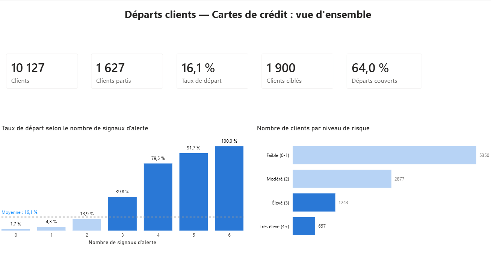
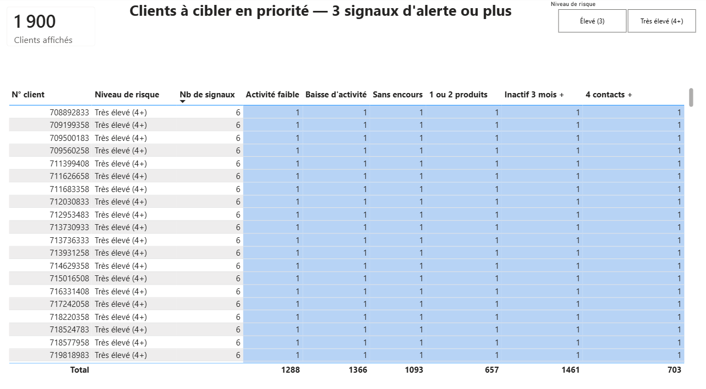

# Départs clients — Cartes de crédit bancaires

**Python · SQL (DuckDB) · Power BI**

> **En bref** : en ciblant **1 900 clients (19 % du portefeuille)** qui cumulent au moins 3 signaux d'alerte, la banque peut toucher **64 % des départs**. Ces signaux sont tous issus de données dont elle dispose déjà.

---

## Contexte et question métier

Une banque constate qu'une part importante de ses clients titulaires d'une carte de crédit résilie leur contrat : **1 627 clients sur 10 127, soit 16,1 %**.

**Question** : quels clients risquent de partir, et quels signaux d'alerte la banque peut-elle surveiller pour agir **avant** le départ ?

---

## Résultats clés



- **Le comportement prime sur le profil** : l'âge, le revenu ou la situation familiale distinguent à peine les clients qui partent (taux entre 14 et 18 %). Leur usage de la carte et leur relation avec la banque, en revanche, font toute la différence.
- **Les départs s'annoncent** : faible activité, baisse d'activité au fil de l'année, inactivité prolongée et contacts répétés sont visibles avant la résiliation.
- **Une cible restreinte concentre le risque** : plus un client cumule de signaux, plus il part. De 1,7 % sans signal à 79,5 % avec 4 signaux.

### Les 6 signaux d'alerte retenus

| Signal | Taux de départ des clients concernés |
|---|---|
| Activité faible (45 transactions ou moins sur 12 mois) | 37,1 % |
| Forte baisse d'activité entre le 1er et le 4e trimestre | 37,6 % |
| Aucun encours sur la carte | 36,2 % |
| 1 ou 2 produits détenus | plus de 25 % |
| 3 mois d'inactivité ou plus | à partir de 21,5 % |
| 4 contacts ou plus avec la banque | à partir de 22,6 % |

*Taux de départ moyen : 16,1 %.*

### Liste opérationnelle pour les conseillers



Chaque client ciblé apparaît avec ses signaux d'alerte, pour que le conseiller sache **quoi lui proposer** avant de l'appeler.

---

## Hypothèses métier

Hypothèses formulées **avant** l'exploration des données, à partir des motifs de départ fréquemment observés dans la relation bancaire, puis confrontées aux chiffres.

| # | Hypothèse | Verdict |
|---|---|---|
| H1 | Le client paie pour une offre qu'il utilise peu | ✅ Confirmée |
| H2 | La situation du client évolue sans que son offre soit ajustée | ✅ Confirmée sur l'usage |
| H3 | La relation est passive : le client ne se manifeste qu'en cas de difficulté | ✅ Confirmée, avec nuance |
| H4 | Les produits détenus ne correspondent pas aux besoins du client | ✅ Confirmée sur l'équipement |
| H5 | Un client qui utilise fortement son crédit se sent moins valorisé | ❌ Infirmée : ce sont les clients **sans** encours qui partent le plus |
| H6 | Les frais sont plus élevés que ceux de la concurrence | ➖ Non testable : aucune donnée tarifaire |

---

## Recommandations

1. **Mettre en place une alerte mensuelle** fondée sur la grille des 6 signaux, transmise aux conseillers avec la liste des clients à contacter.
2. **Prioriser les appels** : contact du conseiller dès 4 signaux (657 clients), offre personnalisée à partir de 3 signaux (1 243 clients).
3. **Renforcer l'équipement** des clients détenant 1 ou 2 produits (épargne, assurance), pour consolider la relation.
4. **Relancer systématiquement** les clients après 3 mois d'inactivité.
5. **Traiter les contacts répétés** comme un risque de départ, et non comme des demandes isolées.
6. **Interroger les clients qui partent** sur leur motif (frais, offre concurrente, qualité du suivi).
7. **Fiabiliser la date d'entrée en relation** des clients, pour intégrer l'ancienneté aux prochaines analyses.

---

## Démarche

| Étape | Contenu | Fichier |
|---|---|---|
| 1. Contrôle qualité | Doublons, valeurs manquantes, valeurs « Unknown », valeurs extrêmes, cohérence des montants | `notebooks/01_controle_fichier.ipynb` |
| 2. Analyse | Cadrage, hypothèses, profil, utilisation de la carte, relation bancaire, ciblage | `notebooks/02_analyse_depart_clients.ipynb` |
| 3. Vérification | Recalcul des chiffres clés en SQL : résultats identiques à Python | `notebooks/03_verification_sql.ipynb`, `sql/verification_chiffres_cles.sql` |
| 4. Restitution | Tableau de bord en 2 pages : vue d'ensemble, clients à cibler | `powerbi/tableau_de_bord_depart_clients.pbix` |

**Chiffres clés vérifiés dans 3 outils** (Python, SQL, Power BI) : 10 127 clients, 16,1 % de départs, 1 900 clients ciblés, 64,0 % des départs couverts.

### Points de vigilance relevés sur les données

- **2 colonnes exclues** : elles contenaient les prédictions d'un modèle calculé par l'auteur du jeu de données, qui reproduisaient le résultat à 100 %.
- **30 % des clients ont au moins une information « Unknown »** (études, revenus, situation familiale). Ils ont été conservés, car leur comportement est proche de la moyenne.
- **Ancienneté peu fiable** : 2 463 clients affichent exactement 36 mois, contre 300 à 360 pour les mois voisins. C'est probablement une valeur attribuée par défaut, donc ce critère n'a pas été retenu pour le ciblage.

### Limites

- Données à un instant donné : pas de date, donc pas d'évolution dans le temps.
- Motif du départ non renseigné, aucune donnée de rentabilité.
- Seuils définis et mesurés sur les mêmes données : à valider sur une nouvelle période avant tout déploiement.

---

## Structure du projet

```
Projet-depart-clients-banque/
├── data/            Données source et fichier préparé pour Power BI
├── notebooks/       Contrôle qualité, analyse, vérification SQL
├── sql/             Requêtes de vérification (DuckDB)
├── powerbi/         Tableau de bord
├── images/          Captures et graphiques
└── requirements.txt Librairies Python utilisées
```

## Reproduire l'analyse

```bash
python -m venv .venv
.venv\Scripts\activate
python -m pip install -r requirements.txt
```

Puis exécuter les notebooks dans l'ordre (01, 02, 03).

---

## Source des données

*Credit Card Customers* (BankChurners), publié sur [Zenodo](https://zenodo.org/records/4322342), sous licence **CC BY 4.0**. Montants en dollars américains.

## Auteure

**Fatima-Zahra FRINDOU** — Data Analyst, après 15 ans en développement commercial et gestion de comptes (IT, banque, assurance, santé).
[Mon profil GitHub](https://github.com/Fatima-Zahra37)